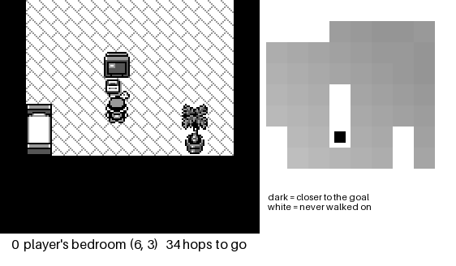

# lepokeyellow

Pokémon Yellow as a testbed for world models and learned agents, on a laptop.
No cloud GPU, and no ROM included.

It started as a port of [stmonty/lePokeRed](https://github.com/stmonty/lePokeRed)
([blog post](https://nostalgia.dev/posts/teaching-a-world-model-to-play-pokemon/)),
which builds on [LeWorldModel](https://arxiv.org/abs/2603.19312) and
[LeJEPA](https://arxiv.org/abs/2511.08544), and grew into three projects:

1. **A world model and a planner** that play the opening of a new game.
2. **A learned policy** that may only see pixels at play time.
3. **Datasets for world models**: emulator play in the PokeDreamer format, and
   the button presses of a 7-hour human playthrough read off its video.



*The planner playing the route from the bedroom to Oak's lab, 111 actions. The
panel on the right is its cost map; the caption is the emulator's ground truth.*

## Results at a glance

| Project | Result | Details |
|---|---|---|
| 1. World model + planner | From the first frame of a new game: gets Pikachu, wins the rival battle, leaves the lab and leaves Pallet Town — **4/4 milestones on 2 of 3 seeds** (3/4 on the third), in 442–873 actions | [docs/part1_world_model_planner.md](docs/part1_world_model_planner.md) |
| 2. Learned policy, pixels only | PPO, 9 h: **0/11** runs reach any objective (same as random). Behaviour clone: **0/33**. Five rounds of DAgger: **10/33** reach `get_parcel` (p = 0.0009 against the clone) | [docs/part2_learned_policy.md](docs/part2_learned_policy.md) |
| 3a. PokeDreamer for Yellow | **500k steps** in colour from 235 start states on **211 maps**; 12.7 maps per 10k steps against 7.0 for the Red original; replays bit-exact | [docs/pokedreamer_yellow.md](docs/pokedreamer_yellow.md) |
| 3b. Longplay button labels | All 8 buttons labelled on **1,485,634 frames** of a 6 h 53 min video, new game to credits; the first 8,097 frames **verified frame by frame** in the emulator, and 5,909 steps and 4,875 text prompts across the whole game checked against the screen | [docs/longplay_labels.md](docs/longplay_labels.md) |

Each doc has the measurements behind its row; the Part 1 and Part 2 docs also
keep the conclusions that turned out wrong and what caught them. Run outputs
are in [`results/`](results/).

## Quick start

You need Python ≥ 3.12, [uv](https://docs.astral.sh/uv/), and **your own
legally acquired Pokémon Yellow ROM** (`.gb` or `.gbc`). No ROM, game asset or
save state is distributed here, and `.gitignore` blocks all three. No GPU or
desktop is required.

```bash
uv sync
uv run pytest     # 509 tests; the ones that need a ROM or save states skip without them

# From a bare ROM to verified save states, with no playing by hand:
uv run python -m scripts.bootstrap --rom pokeyellow.gbc --to pikachu
```

Then, depending on what you want:

| To | Run | More |
|---|---|---|
| Train the world model | `scripts.collect`, then `scripts.train --coord-weight 0.05 --select-on tiles` | [Part 1 commands](docs/part1_world_model_planner.md#commands) |
| Watch the planner play | `scripts.play <checkpoint> --objective coords --controller pursuit` | [Part 1 commands](docs/part1_world_model_planner.md#commands) |
| Run a policy under the contract | `scripts.play2 --policy random --budget 1461` | [Part 2](docs/part2_learned_policy.md#the-harness) |
| Collect PokeDreamer-format data | `scripts.collect_dreamer` | [Reproduce](docs/pokedreamer_yellow.md#reproduce) |
| Label a longplay video | `scripts.video_ingest` → `synth_collect` → `train_idm` → `label_video` → `repair_labels` → `export_video` | [Reproduce](docs/longplay_labels.md#reproduce) |

Every script takes `--help`. Each runs with `uv run python -m scripts.<name>`.

## The three projects

### 1. A world model and a planner

A 12.5M-parameter ViT encoder and a button-conditioned predictor (a JEPA)
learn the game from 31,759 frames, with no rewards or labels. A CEM planner scores plans by where the
model predicts the player will stand. The planner could not cross Pallet
Town until the training objective was made to predict the player's position.
Once that was fixed, the remaining failures were all about pressing the right
button on the right tile. → [docs/part1_world_model_planner.md](docs/part1_world_model_planner.md)

### 2. A learned policy under a play-time contract

`poke/contract.py` enforces the rule: at play time the policy gets pixels and
its current objective, and any attempt to read position from RAM raises.
Training may use anything (RAM rewards, save states, an oracle). Nine hours of
PPO scored the same as random. A clone of the oracle's route knew the way but
drifted off it after five decisions. DAgger, which re-asks the oracle from the
states the clone gets stuck in, is the first thing that reached an objective. →
[docs/part2_learned_policy.md](docs/part2_learned_policy.md)

### 3. Datasets for world models

- **PokeDreamer for Yellow.** The same format as
  [PokeDreamer](https://huggingface.co/datasets/xxxTEMPESTxxx/PokeDreamer)
  (Pokémon Red, grey frames), for Yellow in colour. Teleporting through the
  game's own warp routine lands with control on 228 of 229 maps tried. →
  [docs/pokedreamer_yellow.md](docs/pokedreamer_yellow.md)
- **Button labels from a longplay.** A model trained on emulator play that
  looks like the video reads the presses off every frame. The emulator then
  replays the labels and repairs them wherever the screen stops matching.
  This verification only reaches as far as an emulator state matches the
  video, which in practice means the opening; past it, every step the player
  takes and every text prompt answered is checked against what the screen
  shows. →
  [docs/longplay_labels.md](docs/longplay_labels.md)

Collected data lives in `data/` and is gitignored. Nothing derived from the
video is published: it is someone else's upload.

## Repository layout

| Path | What is there |
|---|---|
| `poke/` | the library: emulator env and Yellow's RAM map, world model (`jepa.py`, `encoder.py`, `predictor.py`), planner pieces, oracle, `contract.py`, RL (`rl/`), warps, dataset writers, the video and labelling models (`video.py`, `synth.py`, `idm.py`) |
| `scripts/` | one entry point per experiment; every one takes `--help` |
| `tests/` | the suite, runnable without a ROM |
| `docs/` | one write-up per project, plus design specs and plans in `docs/superpowers/` |
| `results/` | committed outputs of the runs the docs quote |
| `media/` | the GIFs |
| `routes/` | recorded routes and their annotations |
| `states/`, `data/`, `episodes/`, `checkpoints/` | generated locally; gitignored |

## Roadmap

Done so far: a baseline table before any model, training on real frames,
separating "the model is wrong" from "the objective is wrong", planning on
coordinates instead of a latent norm, and the whole opening (4/4 milestones on
two of three seeds). Next:

1. **Past Route 1 with the world model.** Past Pallet the run walks onto ground
   no episode has covered, where neither the cost field nor the position
   read-out means anything, so the next need is data there, not a better
   planner. Colour data from 211 maps now exists (project 3a); the Part 1
   models still train on grey frames from the opening.
2. **The other two arms of Part 2.** Only one of the design's three arms was
   trained, so nothing yet shows whether the world model helps a policy.
3. **Rollout error as a curve,** `MSE(k)` for `k = 1..H`, before and after
   fine-tuning; `scripts.finetune_rollout` already prints per-horizon
   validation MSE.
4. **Close the encoder's lossiness gap.** Raw pixels predict position better
   than the encoder everywhere. Does an auxiliary coordinate head recover it
   without hurting the dynamics?
5. **Cross-version transfer.** Score the frozen Yellow encoder on Red's
   `leave_room` task with no retraining. Needs a second legal ROM.

## Licence

[MIT](LICENSE). Vendored and adapted portions are MIT from
[stmonty/lePokeRed](https://github.com/stmonty/lePokeRed) — see
[NOTICE](NOTICE) and [LICENSE.upstream](LICENSE.upstream) for the file-by-file
breakdown and the upstream commit.

Pokémon is a trademark of Nintendo / Creatures Inc. / GAME FREAK Inc. This
project is unaffiliated with them and distributes no game content.
