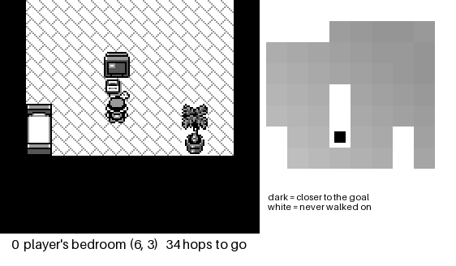
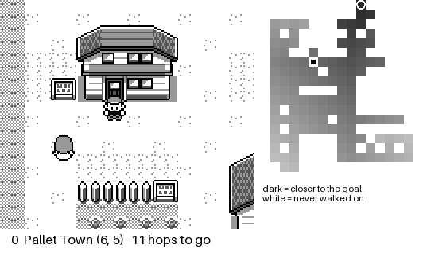

# lepokeyellow

A JEPA world model that learns Pokémon Yellow from pixels, and a planner that
tries to play it. Ported and extended from
[stmonty/lePokeRed](https://github.com/stmonty/lePokeRed)
([blog post](https://nostalgia.dev/posts/teaching-a-world-model-to-play-pokemon/)),
which builds on [LeWorldModel](https://arxiv.org/abs/2603.19312) and
[LeJEPA](https://arxiv.org/abs/2511.08544).

Everything here runs on a laptop. No cloud GPU, no ROM included.

**Where it stands:** from the first frame of a new game, the run reaches
Pikachu, wins the rival's forced battle, leaves Oak's lab and leaves Pallet
Town — **4 of 4 milestones on two of three seeds, 3 of 4 on the third**, in
442-873 actions. The same planner on the previous checkpoint managed 0/3 at
crossing one map. Two separate things had to change. The first was the training
objective: predicting embeddings well turned out not to be the same thing as
predicting the game, and until the objective asked for the player's position it
did not keep it. The second was not about the model at all — a story beat fires
on an exact tile, facing an exact direction, and A is not a safe button to
press, as the run that spent 207 presses trapped in a naming screen
demonstrated. See [four milestones](#four-milestones-from-a-new-game). [What stopped it](#what-stopped-it) is the chain of
measurements that found that, including two fixes that were correct, measurable
and useless. Several confident conclusions along the way were wrong; those are
kept in [Wrong answers](#wrong-answers-and-what-caught-them) because the
controls that caught them are the useful part.

## What it looks like

The caption under each frame is the emulator's own truth — which map, which
tile, how many hops from the target — and for the model runs, the tile it
predicted it would land on. The panel beside it is the cost field of the map
the player is on: dark is closer to the goal, white is ground never walked on
in the dataset, the ring is the target, the square is the player and the dots
are where they have already been.

The whole route, as the planner actually played it — bedroom to Oak's lab in
111 actions, through the cutscene at the north edge of Pallet Town. The
caption names the controller that chose each action.



And what one change to the training objective was worth, on the isolated
navigation task, recorded with identical settings:

| before: MSE + SIGReg | after: + the coordinate loss | the recorded human route |
|---|---|---|
|  |  |  |
| walks back **into the house** | crosses Pallet Town and **triggers the Pikachu encounter** | the human doing the same thing |

The panel is not decoration. Without it these runs are hard to read at all: the
camera is centred on the player, so walking shows up only as the background
scrolling, and a stuck run looks exactly like a still image. It has already
earned itself twice. It showed that a run described here as "oscillating
between two tiles" was actually **stuck in a conversation** — `play.py` mashes
A to clear dialogue, `nav_bench.py` has no such rule, so a run that walks into
an NPC is over. And it showed the fixed planner reaching the Pikachu encounter,
which the benchmark was scoring as a failure because it tested for a tile
rather than for the event.

Reproduce any of them with `scripts/record_gif.py`, which also has `--policy
greedy`, `--policy random` and a `--skip` for jumping an opening stretch of
dialogue.

---

## The model

Unchanged from upstream: a 12.5M-parameter ViT encoder mapping a 144×160
greyscale screen to a 192-dim embedding, a button-conditioned causal predictor,
and MSE on the next embedding plus `0.1 · SIGReg` to stop the representation
collapsing. No rewards, no labels.

What changed is everything around it.

## Why Yellow is not a re-skin of Red

Oak's lab in Yellow holds a single Poké Ball, the rival takes it, and Oak then
hands you Pikachu through dialogue. Nothing you do changes which Pokémon you
get. Upstream encodes its task by naming episodes `charmander` / `squirtle` /
`bulbasaur` and scanning the party count — in the collector, the planner *and*
the evaluator. None of that ports.

Yellow also moved `wGBC` into HRAM, so every WRAM symbol above `$CF1A` sits one
byte lower than Red/Blue. A wrong address does not raise; it returns the
neighbouring byte. Read with Red's map, Yellow's *species index* looks like a
party count.

| Yellow | Red | symbol | how it was confirmed on the cartridge |
|---|---|---|---|
| `0xD162` | `0xD163` | `party_count` | 0 → 1 when Pikachu arrives |
| `0xD163` | `0xD164` | `party_species` | reads 84 — Pikachu's Gen-1 index |
| `0xD35D` | `0xD35E` | `cur_map` | 38 on a new game; 38 → 37 → 0 → 40 along the route |
| `0xD360` | `0xD361` | `wYCoord` | 6 ↔ 7 on down/up |
| `0xD361` | `0xD362` | `wXCoord` | 1 ↔ 4 on left/right |
| `0xD056` | `0xD057` | `wIsInBattle` | reads 2 in the rival fight while Red's `0xD057` stays 0 |

Addresses carry a provenance field and the ROM sha1 they were checked against,
so a later disagreement points at a different dump rather than at the table.

**Yellow is a dual-mode cart** (CGB flag `0x80`), so PyBoy boots it in colour
and R, G and B differ. Every writer takes channel 0 and the encoder is
`Conv2d(1, …)`, so colour would quietly feed the model an arbitrary channel
instead of luminance. The env forces DMG. Upstream never hit this — a `.gb` Red
ROM has no colour mode to pick.

## No hand-made save state

Upstream asks you to play the game and close the window, which makes every
result rest on an artifact nobody else can reproduce. It is unnecessary.
Yellow's whole intro — Oak's speech, both name entries, the walk-on — is cleared
by pressing A, and from the bedroom a seeded random walk finds the way out.

`scripts/bootstrap.py` presses A until the game hands over control, searches for
a target, truncates at first arrival, and **replays the route from the start to
check it lands in the same place** before saving.

| target | from a bare ROM | result |
|---|---|---|
| `bedroom` | 76 A presses, 2.7 s | controllable, map 38, party 0 |
| `oaks_lab` | + 765 search steps, 17 s | map 40 |
| `pikachu` | + 928 search steps, 30 s | map 40, **party 1** |

A random walk is an existence proof, not a demonstration, so
`scripts/prune_route.py` cuts the loops out and replays to verify every cut:
**1,485 → 336** actions on one route, **928 → 454** on another. Most candidate
cuts are rejected, because the `(map, y, x, party, battle)` signature omits
story flags.

## Requirements

- Python ≥ 3.12 and [uv](https://docs.astral.sh/uv/)
- **Your own legally acquired Pokémon Yellow ROM.** No ROM, game asset or save
  state is included or distributed here, and `.gitignore` blocks all three.
  Either a `.gb` or the GBC-enhanced `.gbc` dump works.
- No graphical desktop and no GPU required.

## Run

```bash
uv sync
uv run pytest                      # 196 tests, no ROM and no GPU needed

# Bare ROM -> verified, reproducible save states. No playing required.
uv run python -m scripts.bootstrap --rom pokeyellow.gbc --to pikachu

# Shorten the route it found, verifying every cut.
uv run python -m scripts.prune_route --task yellow_pikachu

# Mark which steps are walked and which are a cutscene.
uv run python -m scripts.annotate_route --task yellow_pikachu

# The baseline table. Do this before believing any planner number.
uv run python -m scripts.eval_baselines

# Collect with locations, then train.
uv run python -m scripts.collect --out episodes/yellow_v3.h5 \
    --demos 4 --noisy 12 --random 400 --random-steps 60 --post-goal 12
uv run python -m scripts.train --data-path episodes/yellow_v3.h5 \
    --coord-weight 0.05 --select-on tiles

# Is the model wrong, or is the objective? Per-action, against the emulator.
uv run python -m scripts.action_check checkpoints/yellow_v2/best.pt

# What does the frozen encoder actually know about position?
uv run python -m scripts.probe_location checkpoints/yellow_v2/best.pt

# Does a non-linear head read it better than ridge does?
uv run python -m scripts.probe_nonlinear checkpoints/yellow_v2/best.pt

# The measurement that matters: predicted position, in tiles, against the
# emulator's own record, with "assume nothing moved" as the baseline.
uv run python -m scripts.rollout_tiles checkpoints/yellow_v2/best.pt

# Navigation, at three levels of zoom: one state, many decisions, a whole run.
uv run python -m scripts.nav_resolution checkpoints/yellow_v2/best.pt
uv run python -m scripts.nav_decisions checkpoints/yellow_v2/best.pt
uv run python -m scripts.nav_bench checkpoints/yellow_v2/best.pt

# Watch it, instead of reading a number: route | cem | greedy | random.
uv run python -m scripts.record_gif checkpoints/yellow_v2/best.pt \
    --policy cem --out media/planner.gif

# Or replay a run that already happened, exactly as it happened.
uv run python -m scripts.record_gif --policy replay \
    --log results/play_coords_v3.json --state states/bedroom.state \
    --target 40,3,5 --out media/play_route.gif

# Play.
uv run python -m scripts.play checkpoints/yellow_v2/best.pt \
    --objective coords --controller pursuit \
    --annotations routes/yellow_pikachu.annotations.json
```

## Measure the trivial baseline first

The blog post reports 52/100 planner successes against uniform random (0/100)
and an untrained predictor (1/100) — then notes in passing that pressing A
repeatedly already works from its start state. That row is not in its table. It
is row one of its own training data: upstream ships `TAKE = ["a"] * 12` as a
scripted route and asserts it reaches a starter.

So `scripts/eval_baselines.py` runs all seven constant-button policies plus
uniform random, and warns if any constant button solves the task.

It also caught a broken task. Starting the Pikachu task inside Oak's lab scores
**0/1 for all seven constant buttons and 0/50 for random** — which reads as
brutally hard and is really impossible: the lab is enterable long before the
story hands anything over. **A table of zeros is a broken task, not a good
result.** Redefined from a new game with a horizon matched to what random needs:

| policy | hits | rate |
|---|---|---|
| every constant button | 0/1 each | 0.0 % |
| uniform random | 1/50 | 2.0 % |

## What the model learned

31,759 frames, 2 minutes to collect, trained in ~70 minutes on an M5 via MPS.
Best checkpoint epoch 10, validation prediction loss 0.0102.

`scripts/action_check.py` scores every action from a state against the real
emulator:

| action | prediction error | no-change baseline | moves the player |
|---|---|---|---|
| down | 0.0111 | 1.5112 | yes |
| left | 0.0021 | 1.3275 | yes |
| right | 0.0300 | 1.3235 | yes |
| a | 0.0018 | 0.1411 | no |
| noop / up / b | ~0.002 | 0.0000 | no |

On the four actions that change the screen the predictor beats "predict no
change" by **44× to 631×**. It picks `down`, `down` really is closest, `down`
moves the player, and it correctly believes `a` makes things worse. The three
that leave the screen byte-identical cannot be scored — the baseline is exactly
0.0 and already right.

**The dynamics model is not the problem.**

## What the encoder knows about position

`(map, y, x)` is recorded for every frame; the emulator knows it for free.
Linear probes on the frozen encoder, split by episode, with raw-pixel and
shuffled-label controls and a swept ridge strength:

| map | axis | encoder R² | MAE (tiles) | raw pixels R² | shuffled R² |
|---|---|---|---|---|---|
| bedroom | y / x | 0.972 / 0.876 | 0.22 / 0.47 | 1.000 / 1.000 | −0.002 |
| Oak's lab | y / x | 0.856 / 0.875 | 0.36 / 0.59 | 0.998 / 0.996 | −0.002 |
| house, ground floor | y / x | 0.767 / 0.765 | 0.69 / 0.78 | 0.982 / 0.992 | −0.001 |
| Pallet Town | y / x | 0.760 / 0.655 | 1.88 / 1.44 | 0.912 / 0.803 | −0.002 |

Position is recoverable on all eight pairs, to within half a tile in three of
four rooms. The encoder is **lossy** — raw downsampled pixels beat it
everywhere — but the information survives.

## Planning on tiles, not on a latent norm

Two ridge heads on the frozen encoder — one-vs-rest for the map, then a per-map
regressor for `y` and `x` — read the player's tile out of an embedding at
**99.5 % map accuracy, ±1.51 tiles**. A plan is then scored on *where the model
thinks the player will end up*, in tiles, rather than on a distance in a space
where position is only one of several things varying.

Waypoints come from the demonstration's own recorded positions, which splits the
two jobs cleanly: **whether we have arrived is read from RAM, and only the
button choice is the model's imagination.** A failure can then only be the
planner's.

The controller is pure pursuit, borrowed from path following: project the real
tile onto the route, aim a couple of nodes further on, repeat. No timer to tune,
nothing abandoned.

| objective | controller | progress | actions |
|---|---|---|---|
| latent goal distance | ladder | 9/46 rungs | 702 |
| latent progress probe | — | oscillated through a door 15× | — |
| coordinates | advance/abandon | 15/38 waypoints | 198 |
| **coordinates** | **pure pursuit** | **22/38 nodes** | **81** |

Progress counts only nodes the player has genuinely **stood on**, within a tile.

Three controllers share the pad and every action records which one chose it:
the planner in the overworld, a scripted A-masher while `wIsInBattle` is set
(43 presses cleared the forced rival fight with Pikachu intact), and the same
masher for dialogue.

Two structural fixes pure pursuit needed, both found by running it:

- **A target in another room gives no gradient.** The wrong-map penalty swamps
  tile distance, every plan that stays in the room ties, CEM has nothing to
  follow. Aim at the route's exit from the *current* room instead.
- **Dialogue ignores the d-pad.** At the north edge of Pallet all seven buttons
  give the identical result, because Oak stops the player and walks them to the
  lab.

## Which steps of a route are a movie

Waypoints from a demonstration cannot tell "somewhere you walked to" from
"somewhere you were carried", and the emulator answers that exactly: at each
step, snapshot, try all seven buttons, compare. If every button gives the same
screen, nothing the planner chooses matters there.

> **42 % of this route is scripted** — 189 of 455 steps. Oak's encounter alone
> is a **116-step** scene starting at map 0 `(0,10)`, the north edge of Pallet.
> The Pikachu handover is another 39.

One trap: control is lost **on** the trigger tile, so the counterfactual marks
it scripted. Dropping it removes the only waypoint that starts the encounter.
The first step of each scripted run is kept.

## What stopped it

**The planner could not cross Pallet Town. The cause was that nothing in the
training objective ever asked a predicted embedding to say where the player is.**

`scripts/nav_bench.py` asks that one question in isolation — start outside the
player's house, reach the tile that triggers Oak's encounter — with no
dialogue, battles or waypoint bookkeeping to confound it. Under one protocol,
three seeds, 120 actions, replanning after every action:

| model | reaches the Pikachu encounter | closest it got (from 12 hops) |
|---|---|---|
| `L_pred + 0.1 · L_reg` | **0/3** | 11 hops — it barely leaves the doorstep |
| the same plus the coordinate loss | **3/3**, in 25–28 actions | 1 hop |

Getting there took ruling out four plausible causes by measurement, and two of
the rejected fixes were more informative than the accepted one.

**Not the horizon, the action repeats, or the walls.** 14 against 30: identical,
0/3. Action repeats of 1, 2 and 4, on the theory that CEM sampling slots
independently draws ten consecutive presses with probability 7⁻¹⁰: identical.
Manhattan distance ignoring walls: the objection was real — the tile due north
of the start is the doorway back into the player's own house — and
`poke/walkmap.py` fixes it properly with BFS over the 31,759 recorded
positions. Identical.

**Not the read-out's resolution,** which is what the previous version of this
section concluded. A linear probe placed the player to 1.44–1.88 tiles in
Pallet Town while adjacent levels of the cost field differ by one hop, so the
signal was genuinely under the instrument's noise floor. `poke/probe_mlp.py`
fixed exactly that — two hidden layers on the same frozen embeddings, Pallet
error to **0.53 and 0.48 tiles**, shuffled-label control at −0.02 — and
navigation did not improve at all.

**Because the planner never reads a real screen.** It decodes the predictor's
output. Held out, in tiles (`scripts/rollout_tiles.py`):

| what is decoded | before | after |
|---|---|---|
| the real frame | 0.22 | 0.03 |
| assume the player never moved | 0.69 | 0.52 |
| **one-step rollout** | **2.42** | **0.27** |

The predictor was three and a half times worse than assuming nothing moved,
while its embedding MSE beat a no-change baseline by 44× to 631×. Those are not
the same quantity and only one of them is what a planner uses. Seeding the
rollout with three real frames the way training does changes nothing (2.32
against 2.34), so it is not a train/test context mismatch.

**And fitting the read-out on predicted embeddings makes it worse.** The
obvious response is to fit the head where it is actually used. That works —
one-step error 2.42 → 0.78 tiles — and the decisions get worse: the share where
the lowest predicted cost belongs to an action that genuinely helps goes from
47.5 % to **0 %**. Calibrating on blurred predictions teaches the conditional
mean of position, which is the part that discards the differences *between*
actions, and ranking is the only thing a planner uses.

So the fix is in the objective. `poke/coord_head.py` reads (y, x) from an
embedding and is trained against the recorded tile on the predictor's output as
well as the encoder's, making the player's position something the prediction
has to carry. `--coord-weight 0.05 --select-on tiles`. Validation tile error on
predicted embeddings reached 0.24 at epoch 6, and the prediction loss improved
too, so it costs nothing it was previously buying.

### Three real defects in the cost field, found on the way

- A flat `unknown` plateau turned a half-tile read-out error into a 60-hop cost
  error whenever rounding landed one cell outside the observed region. Three of
  seven actions scored identically catastrophically. Unvisited cells now cost
  the nearest observed cell plus a penalty per tile of extrapolation, capped.
- The field covered one map, so every tile in another was worth the same
  nothing — the planner walked into the house and sat there for 38 straight
  actions because every option inside looked equally terrible. `WalkMap` now
  records doors and searches across them, which retires the wrong-map penalty.
- BFS over recorded transitions does not count in units of anything: one step
  holds a button for 20 frames and settles for 40, long enough to cross more
  than one tile, so the graph contains two-tile jumps and the field was not
  monotone — (5,5) at 6 hops, (6,6) at 5, (5,6) at 7. Four-adjacency over
  observed tiles gives one hop per tile.

And `min` over the rollout, inherited from the goal objective, scores a plan by
the single most optimistic tile decoded anywhere along 28 actions — a search
for the head's largest mistake. `discounted` is the default now.

### End to end, with the milestone chain

`scripts/play.py` on the same checkpoint now walks the **entire demonstration
route** — 38 of 38 waypoints, in 111 actions, bedroom to the far side of Oak's
lab, through the cutscene at the north edge of Pallet Town. Six separate bugs
stood between the isolated navigation result and that, and every one of them
was in the controller rather than the model:

| what was wrong | what it looked like |
|---|---|
| `play.py` never got the cost field | aims into another map, every plan ties, 60 actions oscillating in the bedroom |
| no memory of a useless action | ten `down` presses into the wall beside the front door |
| dialogue rule could not hand back control | 116 of 162 actions pressing A at a signpost, which changes the screen every press |
| the graph fragmented the map | strides inside the lab reach seven tiles, so 4-adjacency left it in islands and only 12 tiles in the game could reach the waypoint inside it |
| nearest to the last node counted as reaching it | run ends the instant the player steps through the lab door, scoring node 4 |
| looking ahead skipped a scripted node | walks into the lab without the scene that puts Oak in it, then presses A in an empty room |

### Four milestones, from a new game

The milestone chain is now **4/4 on two of three seeds and 3/4 on the third**:
Pikachu, the rival's fight, out of Oak's lab, out of Pallet Town, from the
first frame of a new game in 442-873 actions. Every seed gets the first three.

| seed | milestones | actions |
|---|---|---|
| 0 | 3/4 — walks back into the lab and the field there is flat | 873 |
| 1 | 4/4 | 442 |
| 2 | 4/4 | 490 |

Getting there was not navigation. It was learning what a Game Boy does with a
button, and every fix below came from a measurement on the cartridge:

| what was wrong | what it looked like |
|---|---|
| the hand-over fires on a tile, not in a room | the route's last waypoint is `(3, 5)`, where the scene CARRIES the player; the tile that starts it is `(4, 7)`, and the run stood on the first under its own power, reported 38/38 complete, and pressed A at a table that was not there for 489 actions |
| and on a direction | reached facing east, 60 A presses do nothing; one `up` first and the party holds a Pikachu 34 presses later |
| A is not a safe button | the scene ends on "give a nickname?", and A answers YES — into a naming screen where A types a letter, B deletes one, and the exit is a button this action set does not have. 207 A presses at one tile, unable to move. `down` then A declines it |
| B is not an answer either | in Gen 1 it does not advance text at all: 24 B presses left Oak mid-sentence |
| a memory of what does nothing goes stale | A, blocked against a closed text box, stayed blocked once the player could no longer move, and 488 planner actions went to `right` with A masked out of every plan |
| four-adjacency invents floor | `(4, 4)` and `(4, 5)` are both recorded and a counter runs between them — `(4, 5)` is only in the data because a cutscene put the player there. The field read one hop; the planner pressed right 33 times |
| the route restarted each milestone | after the rival's fight, 207 of 336 actions pursued a node four tiles behind, and the lab door was never aimed at |
| a tile can appear twice | `(0, 10)` is both where Oak stops the player and where leaving Pallet happens; Oak's scene steps onto it twice, which marked the exit done before the player had a Pokemon |
| and the exit needs the exact tile | at tolerance 1 the route called itself finished from `(1, 10)`, one short, then spent 574 fallback actions with nothing aiming at the exit |
| whether a tile can be landed on depends on the side | `(4, 7)` can only be stepped onto from below — the table north of it stops that walk after one tile, while along row 4 a press goes straight past. Approaching on one axis only: 0/4 |

So the honest summary of the previous result is that it was not a navigation
problem at all. The planner had been walking the route for some time; what it
could not do was *press the right button on the right square*, and nothing in
the objective or the cost field had anything to say about that.

### What still stops it

**Committing more than one action at a time.** Attributed directly: with
`--commit 1` the planner reaches the encounter 3/3 at every horizon tried; with
`--commit 2` it is 1/3 at horizon 2 and 0/3 at 8 and 14. The second action of a
plan is chosen from a predicted state, and one emulator step can cross more
than one tile. `play.py` used to commit 3.

**Standing on the exact trigger tile.** 0/3 across every setting, though all
three seeds get within one hop and all three reach the encounter from the tile
beside it. This is what `--script-approach` now steps in for: inside two tiles
of a trigger, the controller walks onto it by the coordinate the emulator
reports, and the log counts those actions under their own name rather than the
planner's. On the runs above that is 4-24 actions of 442-873. Inspecting the last decision, the model picks `up` correctly and
scores it 0 — and also scores `right` 0, which really costs 2. The remaining
failure is a tie between the right action and a mispredicted one, not a missing
gradient. An oracle that scores actions on the emulator's own coordinates walks
it in 7 actions, so the path is there.

**Dialogue, in the benchmarks.** `play.py` mashes A to clear a text box;
`nav_bench.py` and `nav_decisions.py` have no such rule, so a run that walks
into an NPC is finished. Checked rather than assumed on the runs reported here:
1 of 60 decisions had no button that could change the cost.

Two things that did **not** help, recorded because the measurement is the point:

- Filtering waypoints by the cutscene annotations changed nothing end to end,
  because the run stalls long before that region. Kept because it is correct.
- A principled cutscene detector — comparing two buttons' screens live —
  measured **worse**, 17/38 against 22/38. The cruder "tile has not moved" rule
  is the better *policy* because it mashes A more, advancing text the planner
  would otherwise sit through. `--control-probe` switches.

## Wrong answers, and what caught them

Each of these looked clean and was published before the check that killed it.

1. **"The planner just mashes A."** It did — 291 of 501 actions. But the start
   state was mid-dialogue, where any button merely dismisses a text box. The
   control probe that cleared it asked whether a direction moved the player;
   a text box swallows every button, so nothing moves and every button gives
   the *same screen*. Comparing **two** buttons fixes it. With a clean start the
   `a` share fell to 12 % and tiles visited went 17 → 83.
2. **"Route position is recoverable, so swap the planner's cost."** R² 0.697
   looked convincing. Splitting by map showed it was carried by map identity.
3. **"The encoder is a map detector with no sense of place."** Wrong too — that
   rested on 235 frames of one route through one room where position barely
   varies. With 31,759 frames and recorded coordinates, within-room position is
   recoverable everywhere. Route position was only ±55 actions because the
   question is ill-posed: **95 % of the route's frames sit on a tile it
   revisits**, up to 229 actions apart. One screenshot cannot say how far
   through a route you are.
4. **"22/38 nodes."** The first version scored the *nearest* node at any
   distance, claiming node 22 while the player stood 8 tiles away and had never
   entered the lab. Progress now requires arrival.
5. **"Navigation is blocked by the read-out's resolution."** The previous commit
   measured that correctly and drew the wrong conclusion from it. A non-linear
   head cut Pallet Town error from 1.88 to 0.53 tiles, below the one-tile
   granularity the cost field needs, and navigation did not improve at all —
   because the planner never reads a real screen. See
   [What stopped it](#what-stopped-it).
6. **"So fit the read-out on predicted embeddings instead."** It works, and it
   makes the planner worse: one-step error 2.42 → 0.78 tiles, while the share of
   decisions that pick a genuinely helpful action goes 47.5 % → **0 %**. Fitting
   on predicted features teaches the conditional mean of position given a
   blurred prediction, which is the part that throws away the differences
   *between* actions — and ranking is the only thing a planner uses. Accuracy
   and usefulness pointed in opposite directions, and only the decision-level
   metric showed it.

Two methodology notes from the same stretch: contiguous blocked CV over a
monotonic target is extrapolation, not interpolation — it reported R² −25 while
the same features beat the mean on absolute error — and a single arbitrary ridge
strength flipped a conclusion, α=1.0 giving −0.100 where α=100 gives 0.697.

## Cost

Measured on an Apple M5 (32 GB), torch on MPS.

| step | measured |
|---|---|
| parameters | 12,515,136 |
| training throughput | 403 frames/s, flat from batch 16 to 64 |
| 10-epoch run | ~70 min |
| encoder share of a training step | 94 % |
| SIGReg share | 1.5 % |
| CEM, 512 plans, horizon 14 | 173 ms per round |
| bare ROM → verified Pikachu state | 30 s |
| collect 31,759 frames | 2 min |

CEM cost is linear in the horizon, so longer-horizon planning is affordable.

## Upstream fixes

Carried into the vendored code, each with a header saying what changed:

- **Device selection ignored MPS**, so training on an Apple box silently ran on
  CPU.
- **Best-checkpoint selection was driven by the regulariser.** Total validation
  loss is `pred + 0.1 · SIGReg`, and SIGReg dominated it — epochs with strictly
  better prediction were rejected. `--select-on pred` is now the default, and it
  changed which model we plan with.
- `probe.py` labelled frames on `party_counts > 0`, constant for a navigation
  task.
- `PokeDataset` raised numpy's "need at least one array to concatenate" when no
  window fit, naming neither the file nor the knob.
- `train.py`'s config was edit-the-source-only.
- `plan_cem.py` demanded a ROM it never emulates.
- Dropped `eval_plan.py --runs N`: the emulator is deterministic from a save
  state and the plan is fixed, so N runs are N identical episodes.

## Roadmap

1. ~~Baseline table before any model exists.~~ Done.
2. ~~Train on real frames.~~ Done.
3. ~~Separate "is the model wrong" from "is the objective wrong".~~ Done.
4. ~~Plan on coordinates rather than a latent norm.~~ Done.
5. ~~Cross Pallet Town.~~ Done, and then the whole opening: 4/4 milestones on
   two of three seeds.
5b. **Past Route 1.** The run leaves Pallet onto ground no episode has ever
   walked, where neither the cost field nor the position read-out means
   anything — so the next thing is data out there, not a better planner.
6. Rollout error as a curve, `MSE(k)` for `k = 1..H`, before and after
   fine-tuning. `finetune_rollout` already prints per-horizon validation MSE.
7. Close the lossiness gap: raw pixels out-predict the encoder on position
   everywhere. Does an auxiliary coordinate head recover it without hurting the
   dynamics?
8. Cross-version transfer: train on Yellow, score the frozen encoder on Red's
   `leave_room` with no retraining. Needs a second legal ROM.

## Licence

[MIT](LICENSE). Vendored and adapted portions are MIT from
[stmonty/lePokeRed](https://github.com/stmonty/lePokeRed) — see
[NOTICE](NOTICE) and [LICENSE.upstream](LICENSE.upstream) for the file-by-file
breakdown and the upstream commit.

Pokémon is a trademark of Nintendo / Creatures Inc. / GAME FREAK Inc. This
project is unaffiliated with them and distributes no game content.
