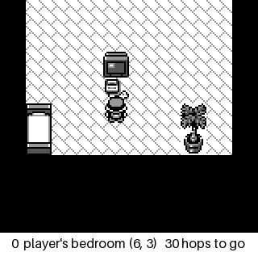
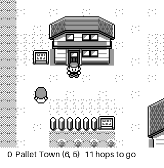

# lepokeyellow

A JEPA world model that learns Pokémon Yellow from pixels, and a planner that
tries to play it. Ported and extended from
[stmonty/lePokeRed](https://github.com/stmonty/lePokeRed)
([blog post](https://nostalgia.dev/posts/teaching-a-world-model-to-play-pokemon/)),
which builds on [LeWorldModel](https://arxiv.org/abs/2603.19312) and
[LeJEPA](https://arxiv.org/abs/2511.08544).

Everything here runs on a laptop. No cloud GPU, no ROM included.

**Where it stands:** the world model predicts embeddings well — one-step
prediction beats a no-change baseline by 44× to 631× in embedding MSE — and
that turned out not to be the same thing as predicting the game. Decoded into
tiles, the same one-step prediction is **worse than assuming the player never
moved**, which is why the planner gets about 60 % of the way to Pikachu and
then cannot cross one open map. [What stops it](#what-stops-it) is the chain of
measurements that found it. Several confident conclusions along the way turned
out to be wrong; those are kept in
[Wrong answers](#wrong-answers-and-what-caught-them) because the controls that
caught them are the useful part.

## What it looks like

Same save state, same cost field, 2× scale. The caption under each frame is the
emulator's own truth — which map, which tile, how many hops from the target —
and for the planner, the tile it predicted it would land on.

| the recorded human route | the planner | one-step greedy |
|---|---|---|
|  |  |  |
| 120 actions, bedroom → Pallet Town | 30 actions, ends **inside the house** | 50 actions, oscillates on two tiles |

The middle one is the failure this README is mostly about, and it is easier to
watch than to argue about: the planner leaves the doorstep, walks back through
the door it came out of, and the caption shows it predicting a tile it is not
on. Reproduce any of them with `scripts/record_gif.py`.

---

## The model

Unchanged from upstream: a 12.5M-parameter ViT encoder mapping a 144×160
greyscale screen to a 192-dim embedding, a button-conditioned causal predictor,
and MSE on the next embedding plus `0.1 · SIGReg` to stop the representation
collapsing. No rewards, no labels.

What changed is everything around it.

## Why Yellow is not a re-skin of Red

Oak's lab in Yellow holds a single Poké Ball, the rival takes it, and Oak then
hands you Pikachu through dialogue. Nothing you do changes which Pokémon you
get. Upstream encodes its task by naming episodes `charmander` / `squirtle` /
`bulbasaur` and scanning the party count — in the collector, the planner *and*
the evaluator. None of that ports.

Yellow also moved `wGBC` into HRAM, so every WRAM symbol above `$CF1A` sits one
byte lower than Red/Blue. A wrong address does not raise; it returns the
neighbouring byte. Read with Red's map, Yellow's *species index* looks like a
party count.

| Yellow | Red | symbol | how it was confirmed on the cartridge |
|---|---|---|---|
| `0xD162` | `0xD163` | `party_count` | 0 → 1 when Pikachu arrives |
| `0xD163` | `0xD164` | `party_species` | reads 84 — Pikachu's Gen-1 index |
| `0xD35D` | `0xD35E` | `cur_map` | 38 on a new game; 38 → 37 → 0 → 40 along the route |
| `0xD360` | `0xD361` | `wYCoord` | 6 ↔ 7 on down/up |
| `0xD361` | `0xD362` | `wXCoord` | 1 ↔ 4 on left/right |
| `0xD056` | `0xD057` | `wIsInBattle` | reads 2 in the rival fight while Red's `0xD057` stays 0 |

Addresses carry a provenance field and the ROM sha1 they were checked against,
so a later disagreement points at a different dump rather than at the table.

**Yellow is a dual-mode cart** (CGB flag `0x80`), so PyBoy boots it in colour
and R, G and B differ. Every writer takes channel 0 and the encoder is
`Conv2d(1, …)`, so colour would quietly feed the model an arbitrary channel
instead of luminance. The env forces DMG. Upstream never hit this — a `.gb` Red
ROM has no colour mode to pick.

## No hand-made save state

Upstream asks you to play the game and close the window, which makes every
result rest on an artifact nobody else can reproduce. It is unnecessary.
Yellow's whole intro — Oak's speech, both name entries, the walk-on — is cleared
by pressing A, and from the bedroom a seeded random walk finds the way out.

`scripts/bootstrap.py` presses A until the game hands over control, searches for
a target, truncates at first arrival, and **replays the route from the start to
check it lands in the same place** before saving.

| target | from a bare ROM | result |
|---|---|---|
| `bedroom` | 76 A presses, 2.7 s | controllable, map 38, party 0 |
| `oaks_lab` | + 765 search steps, 17 s | map 40 |
| `pikachu` | + 928 search steps, 30 s | map 40, **party 1** |

A random walk is an existence proof, not a demonstration, so
`scripts/prune_route.py` cuts the loops out and replays to verify every cut:
**1,485 → 336** actions on one route, **928 → 454** on another. Most candidate
cuts are rejected, because the `(map, y, x, party, battle)` signature omits
story flags.

## Requirements

- Python ≥ 3.12 and [uv](https://docs.astral.sh/uv/)
- **Your own legally acquired Pokémon Yellow ROM.** No ROM, game asset or save
  state is included or distributed here, and `.gitignore` blocks all three.
  Either a `.gb` or the GBC-enhanced `.gbc` dump works.
- No graphical desktop and no GPU required.

## Run

```bash
uv sync
uv run pytest                      # 196 tests, no ROM and no GPU needed

# Bare ROM -> verified, reproducible save states. No playing required.
uv run python -m scripts.bootstrap --rom pokeyellow.gbc --to pikachu

# Shorten the route it found, verifying every cut.
uv run python -m scripts.prune_route --task yellow_pikachu

# Mark which steps are walked and which are a cutscene.
uv run python -m scripts.annotate_route --task yellow_pikachu

# The baseline table. Do this before believing any planner number.
uv run python -m scripts.eval_baselines

# Collect with locations, then train.
uv run python -m scripts.collect --out episodes/yellow_v3.h5 \
    --demos 4 --noisy 12 --random 400 --random-steps 60 --post-goal 12
uv run python -m scripts.train --data-path episodes/yellow_v3.h5 \
    --coord-weight 0.05 --select-on tiles

# Is the model wrong, or is the objective? Per-action, against the emulator.
uv run python -m scripts.action_check checkpoints/yellow_v2/best.pt

# What does the frozen encoder actually know about position?
uv run python -m scripts.probe_location checkpoints/yellow_v2/best.pt

# Does a non-linear head read it better than ridge does?
uv run python -m scripts.probe_nonlinear checkpoints/yellow_v2/best.pt

# The measurement that matters: predicted position, in tiles, against the
# emulator's own record, with "assume nothing moved" as the baseline.
uv run python -m scripts.rollout_tiles checkpoints/yellow_v2/best.pt

# Navigation, at three levels of zoom: one state, many decisions, a whole run.
uv run python -m scripts.nav_resolution checkpoints/yellow_v2/best.pt
uv run python -m scripts.nav_decisions checkpoints/yellow_v2/best.pt
uv run python -m scripts.nav_bench checkpoints/yellow_v2/best.pt

# Watch it, instead of reading a number: route | cem | greedy | random.
uv run python -m scripts.record_gif checkpoints/yellow_v2/best.pt \
    --policy cem --out media/planner.gif

# Play.
uv run python -m scripts.play checkpoints/yellow_v2/best.pt \
    --objective coords --controller pursuit \
    --annotations routes/yellow_pikachu.annotations.json
```

## Measure the trivial baseline first

The blog post reports 52/100 planner successes against uniform random (0/100)
and an untrained predictor (1/100) — then notes in passing that pressing A
repeatedly already works from its start state. That row is not in its table. It
is row one of its own training data: upstream ships `TAKE = ["a"] * 12` as a
scripted route and asserts it reaches a starter.

So `scripts/eval_baselines.py` runs all seven constant-button policies plus
uniform random, and warns if any constant button solves the task.

It also caught a broken task. Starting the Pikachu task inside Oak's lab scores
**0/1 for all seven constant buttons and 0/50 for random** — which reads as
brutally hard and is really impossible: the lab is enterable long before the
story hands anything over. **A table of zeros is a broken task, not a good
result.** Redefined from a new game with a horizon matched to what random needs:

| policy | hits | rate |
|---|---|---|
| every constant button | 0/1 each | 0.0 % |
| uniform random | 1/50 | 2.0 % |

## What the model learned

31,759 frames, 2 minutes to collect, trained in ~70 minutes on an M5 via MPS.
Best checkpoint epoch 10, validation prediction loss 0.0102.

`scripts/action_check.py` scores every action from a state against the real
emulator:

| action | prediction error | no-change baseline | moves the player |
|---|---|---|---|
| down | 0.0111 | 1.5112 | yes |
| left | 0.0021 | 1.3275 | yes |
| right | 0.0300 | 1.3235 | yes |
| a | 0.0018 | 0.1411 | no |
| noop / up / b | ~0.002 | 0.0000 | no |

On the four actions that change the screen the predictor beats "predict no
change" by **44× to 631×**. It picks `down`, `down` really is closest, `down`
moves the player, and it correctly believes `a` makes things worse. The three
that leave the screen byte-identical cannot be scored — the baseline is exactly
0.0 and already right.

**The dynamics model is not the problem.**

## What the encoder knows about position

`(map, y, x)` is recorded for every frame; the emulator knows it for free.
Linear probes on the frozen encoder, split by episode, with raw-pixel and
shuffled-label controls and a swept ridge strength:

| map | axis | encoder R² | MAE (tiles) | raw pixels R² | shuffled R² |
|---|---|---|---|---|---|
| bedroom | y / x | 0.972 / 0.876 | 0.22 / 0.47 | 1.000 / 1.000 | −0.002 |
| Oak's lab | y / x | 0.856 / 0.875 | 0.36 / 0.59 | 0.998 / 0.996 | −0.002 |
| house, ground floor | y / x | 0.767 / 0.765 | 0.69 / 0.78 | 0.982 / 0.992 | −0.001 |
| Pallet Town | y / x | 0.760 / 0.655 | 1.88 / 1.44 | 0.912 / 0.803 | −0.002 |

Position is recoverable on all eight pairs, to within half a tile in three of
four rooms. The encoder is **lossy** — raw downsampled pixels beat it
everywhere — but the information survives.

## Planning on tiles, not on a latent norm

Two ridge heads on the frozen encoder — one-vs-rest for the map, then a per-map
regressor for `y` and `x` — read the player's tile out of an embedding at
**99.5 % map accuracy, ±1.51 tiles**. A plan is then scored on *where the model
thinks the player will end up*, in tiles, rather than on a distance in a space
where position is only one of several things varying.

Waypoints come from the demonstration's own recorded positions, which splits the
two jobs cleanly: **whether we have arrived is read from RAM, and only the
button choice is the model's imagination.** A failure can then only be the
planner's.

The controller is pure pursuit, borrowed from path following: project the real
tile onto the route, aim a couple of nodes further on, repeat. No timer to tune,
nothing abandoned.

| objective | controller | progress | actions |
|---|---|---|---|
| latent goal distance | ladder | 9/46 rungs | 702 |
| latent progress probe | — | oscillated through a door 15× | — |
| coordinates | advance/abandon | 15/38 waypoints | 198 |
| **coordinates** | **pure pursuit** | **22/38 nodes** | **81** |

Progress counts only nodes the player has genuinely **stood on**, within a tile.

Three controllers share the pad and every action records which one chose it:
the planner in the overworld, a scripted A-masher while `wIsInBattle` is set
(43 presses cleared the forced rival fight with Pikachu intact), and the same
masher for dialogue.

Two structural fixes pure pursuit needed, both found by running it:

- **A target in another room gives no gradient.** The wrong-map penalty swamps
  tile distance, every plan that stays in the room ties, CEM has nothing to
  follow. Aim at the route's exit from the *current* room instead.
- **Dialogue ignores the d-pad.** At the north edge of Pallet all seven buttons
  give the identical result, because Oak stops the player and walks them to the
  lab.

## Which steps of a route are a movie

Waypoints from a demonstration cannot tell "somewhere you walked to" from
"somewhere you were carried", and the emulator answers that exactly: at each
step, snapshot, try all seven buttons, compare. If every button gives the same
screen, nothing the planner chooses matters there.

> **42 % of this route is scripted** — 189 of 455 steps. Oak's encounter alone
> is a **116-step** scene starting at map 0 `(0,10)`, the north edge of Pallet.
> The Pikachu handover is another 39.

One trap: control is lost **on** the trigger tile, so the counterfactual marks
it scripted. Dropping it removes the only waypoint that starts the encounter.
The first step of each scripted run is kept.

## What stops it

**The planner cannot cross Pallet Town, and the reason is resolution.**

`scripts/nav_bench.py` asks that one question in isolation — start outside the
player's house, reach the tile that triggers Oak's encounter — with no
dialogue, battles or waypoint bookkeeping to confound it. The true path is
**6 hops**. Nothing reached it, 0/3 seeds, under every setting tried.

Three plausible causes, all ruled out by measurement:

| suspect | test | result |
|---|---|---|
| horizon too short | 14 vs 30 | identical, 0/3 |
| CEM cannot propose a run of one button | action repeats 1, 2, 4 | identical, 0/3 |
| Manhattan distance ignores walls | BFS over observed transitions | identical, 0/3 |

The walls objection was real — the tile due north of the start is the doorway
back into the player's own house, so a greedy "reduce |dy| + |dx|" walks inside
— and `poke/walkmap.py` fixes it properly, building a graph from the 31,759
recorded positions and scoring on BFS hops. It changed nothing, which is how
the actual cause surfaced.

Comparing the model's predicted tile against the real one, per action, from the
same state:

| action | model thinks | its BFS cost | real tile | real BFS cost |
|---|---|---|---|---|
| noop | (5.8, 7.2) | 7 | (6, 5) | 6 |
| up | (5.3, 7.2) | 60 | **map 37** | 60 |
| down | (7.1, 7.1) | 7 | (8, 5) | 7 |
| left | (6.1, 6.8) | 7 | (6, 4) | 6 |
| **right** | (6.6, 7.5) | 7 | (6, 6) | **5** |
| b | (6.0, 7.2) | 7 | (6, 5) | 6 |

Predicted `x` is about 7.2 for every action while the truth is 5, and varies
only between 6.8 and 7.5 across all seven. `right` genuinely improves the
distance from 6 to 5; the model scores it 7, the same as standing still.

**Adjacent BFS levels differ by one tile. The probe's error in Pallet Town is
1.44–1.88 tiles.** The signal the planner needs is below the noise floor of the
instrument reading it. Map classification is unaffected — `up` is correctly
predicted to enter map 37 — which is why map-to-map progress worked and
within-map navigation does not.

The encoder is not the ceiling either: raw downsampled pixels probe Pallet
position better than it does (R² 0.912/0.803 against 0.760/0.655), so more
signal exists than a linear readout extracts. A non-linear head, or more Pallet
data — it is 3,233 of 31,759 frames while the bedroom is 76 % — are the cheap
next tests.

Two things that did **not** help, recorded because the measurement is the point:

- Filtering waypoints by the cutscene annotations changed nothing end to end,
  because the run stalls long before that region. Kept because it is correct.
- A principled cutscene detector — comparing two buttons' screens live —
  measured **worse**, 17/38 against 22/38. The cruder "tile has not moved" rule
  is the better *policy* because it mashes A more, advancing text the planner
  would otherwise sit through. `--control-probe` switches.

## Wrong answers, and what caught them

Each of these looked clean and was published before the check that killed it.

1. **"The planner just mashes A."** It did — 291 of 501 actions. But the start
   state was mid-dialogue, where any button merely dismisses a text box. The
   control probe that cleared it asked whether a direction moved the player;
   a text box swallows every button, so nothing moves and every button gives
   the *same screen*. Comparing **two** buttons fixes it. With a clean start the
   `a` share fell to 12 % and tiles visited went 17 → 83.
2. **"Route position is recoverable, so swap the planner's cost."** R² 0.697
   looked convincing. Splitting by map showed it was carried by map identity.
3. **"The encoder is a map detector with no sense of place."** Wrong too — that
   rested on 235 frames of one route through one room where position barely
   varies. With 31,759 frames and recorded coordinates, within-room position is
   recoverable everywhere. Route position was only ±55 actions because the
   question is ill-posed: **95 % of the route's frames sit on a tile it
   revisits**, up to 229 actions apart. One screenshot cannot say how far
   through a route you are.
4. **"22/38 nodes."** The first version scored the *nearest* node at any
   distance, claiming node 22 while the player stood 8 tiles away and had never
   entered the lab. Progress now requires arrival.
5. **"Navigation is blocked by the read-out's resolution."** The previous commit
   measured that correctly and drew the wrong conclusion from it. A non-linear
   head cut Pallet Town error from 1.88 to 0.53 tiles, below the one-tile
   granularity the cost field needs, and navigation did not improve at all —
   because the planner never reads a real screen. See
   [What stops it](#what-stops-it).
6. **"So fit the read-out on predicted embeddings instead."** It works, and it
   makes the planner worse: one-step error 2.42 → 0.78 tiles, while the share of
   decisions that pick a genuinely helpful action goes 47.5 % → **0 %**. Fitting
   on predicted features teaches the conditional mean of position given a
   blurred prediction, which is the part that throws away the differences
   *between* actions — and ranking is the only thing a planner uses. Accuracy
   and usefulness pointed in opposite directions, and only the decision-level
   metric showed it.

Two methodology notes from the same stretch: contiguous blocked CV over a
monotonic target is extrapolation, not interpolation — it reported R² −25 while
the same features beat the mean on absolute error — and a single arbitrary ridge
strength flipped a conclusion, α=1.0 giving −0.100 where α=100 gives 0.697.

## Cost

Measured on an Apple M5 (32 GB), torch on MPS.

| step | measured |
|---|---|
| parameters | 12,515,136 |
| training throughput | 403 frames/s, flat from batch 16 to 64 |
| 10-epoch run | ~70 min |
| encoder share of a training step | 94 % |
| SIGReg share | 1.5 % |
| CEM, 512 plans, horizon 14 | 173 ms per round |
| bare ROM → verified Pikachu state | 30 s |
| collect 31,759 frames | 2 min |

CEM cost is linear in the horizon, so longer-horizon planning is affordable.

## Upstream fixes

Carried into the vendored code, each with a header saying what changed:

- **Device selection ignored MPS**, so training on an Apple box silently ran on
  CPU.
- **Best-checkpoint selection was driven by the regulariser.** Total validation
  loss is `pred + 0.1 · SIGReg`, and SIGReg dominated it — epochs with strictly
  better prediction were rejected. `--select-on pred` is now the default, and it
  changed which model we plan with.
- `probe.py` labelled frames on `party_counts > 0`, constant for a navigation
  task.
- `PokeDataset` raised numpy's "need at least one array to concatenate" when no
  window fit, naming neither the file nor the knob.
- `train.py`'s config was edit-the-source-only.
- `plan_cem.py` demanded a ROM it never emulates.
- Dropped `eval_plan.py --runs N`: the emulator is deterministic from a save
  state and the plan is fixed, so N runs are N identical episodes.

## Roadmap

1. ~~Baseline table before any model exists.~~ Done.
2. ~~Train on real frames.~~ Done.
3. ~~Separate "is the model wrong" from "is the objective wrong".~~ Done.
4. ~~Plan on coordinates rather than a latent norm.~~ Done.
5. **Cross Pallet Town.** Longer horizon, action repeats in the CEM proposal, or
   a coarse walkable-tile search with the model used locally.
6. Rollout error as a curve, `MSE(k)` for `k = 1..H`, before and after
   fine-tuning. `finetune_rollout` already prints per-horizon validation MSE.
7. Close the lossiness gap: raw pixels out-predict the encoder on position
   everywhere. Does an auxiliary coordinate head recover it without hurting the
   dynamics?
8. Cross-version transfer: train on Yellow, score the frozen encoder on Red's
   `leave_room` with no retraining. Needs a second legal ROM.

## Licence

[MIT](LICENSE). Vendored and adapted portions are MIT from
[stmonty/lePokeRed](https://github.com/stmonty/lePokeRed) — see
[NOTICE](NOTICE) and [LICENSE.upstream](LICENSE.upstream) for the file-by-file
breakdown and the upstream commit.

Pokémon is a trademark of Nintendo / Creatures Inc. / GAME FREAK Inc. This
project is unaffiliated with them and distributes no game content.
